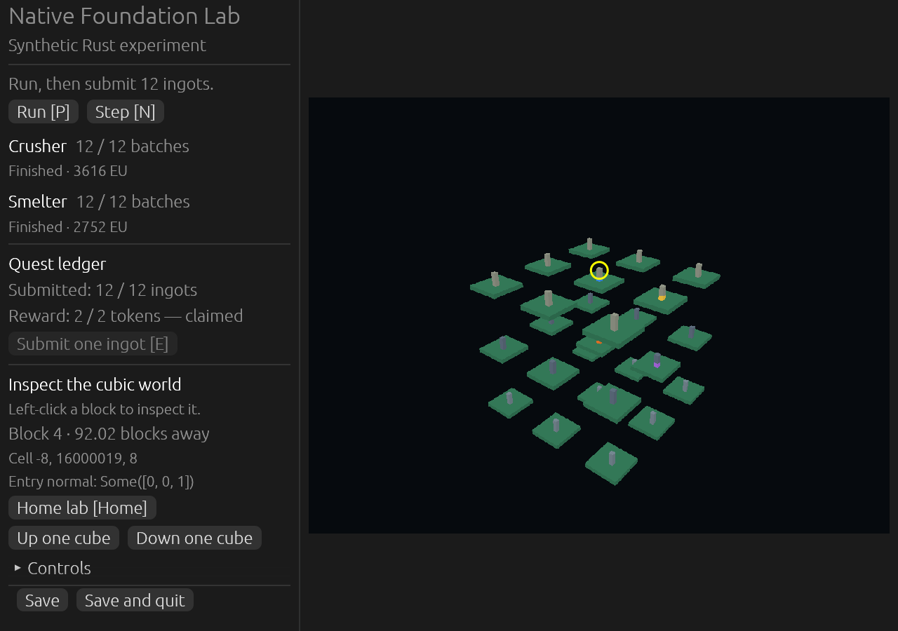

# GTNH Native Rust

A complete, one-to-one native Rust port of GregTech: New Horizons is the project goal: every mod, all content and behavior, progression through the endgame, and cross-mod interactions. This is early development. The complete pack is not implemented or loadable yet.

The separately playable Rust Minecraft base lives in the [Rust Horizons GTNH engine fork](https://github.com/finalpantasy/rust-horizons-gtnh), based on [Horizon](https://github.com/horizon-rust/horizon). This repository owns the native GTNH pack and its compatibility tests. Pack-specific gameplay must remain optional for vanilla play.



Actual development-lab capture: synthetic processing, quest submission/reward accounting and cubic inspection. It demonstrates the current foundation libraries, not completed GTNH content or final game presentation.

## Current code

`native-foundation/` is a runnable independent experiment containing industrial simulation, item/fluid transfers, quest primitives, transactional storage, cubic streaming, budgeted GPU resources and a native inspection viewer. The world/rendering modules are integration experiments pending adoption into the engine; they are not permanent GTNH-only engine requirements. `bridges/horizon_machine.rs` is the separately verified Horizon adapter experiment from which the packaged reference compressor bridge was developed.

The current recipes/tasks in the lab are synthetic. Six separately labeled compressor parameter fixtures record source-declared facts, not complete registered-recipe parity. `reference/gtnh-2.9.0/mods.json` retains all 243 pinned manifest entries with explicit unfinished status. No upstream mod is silently dropped.

[Native bundle packaging](docs/native-bundle-proof.md) now carries the industrial and quest libraries through Horizon's existing `.hnmod` system. The real Windows launcher built and installed two independent test mods, and both hooks ran in a fresh offscreen world with a clean shutdown and unchanged final inputs. This verifies library packaging and hook composition; complete pack parity remains unfinished.

The [reference compressor prototype](docs/reference-compressor.md) now also runs through Horizon's normal native/content mod boundary. Its six declared recipes passed real menu transfers, exact test-energy accounting, server chunk unload/resume, repeated world saves/reopens, blocked output, and bounded hopper checks. This is a verified processing slice with explicitly supplied test power; the full GTNH machine and progression systems remain unfinished.

The separate [LV compressor evaluation](docs/lv-compressor.md) matches all 1,204 measured sand-processing reference rows, including recovery after power loss. The corrected source package also builds and installs through a patched Windows launcher, then passes four fresh native save/reopen sessions using normal content-mod discovery. Active work, charged recovery, player inventory, and collected output persist without duplication. The portable source tool keeps both Rust libraries separate. The earlier 1,204-row comparison has not been rerun against this installed executable. Production electrical networks, unmodified stock-launcher support, and complete pack parity remain unfinished.

## Run the library checks

The commands below require Rust 1.95 or newer because they include the desktop viewer. The core libraries separately declare Rust 1.90.

```sh
cargo test --manifest-path native-foundation/Cargo.toml --workspace --all-features --locked
cargo run --manifest-path native-foundation/Cargo.toml -p foundation-viewer --features desktop -- --new
```

The viewer is a separate technical lab, not the first-person Horizon client. Its current graphics backends are Vulkan and DX12; Metal is not configured. Test fixtures create private temporary worlds. On Windows, filesystem and graphics permissions must allow those operations.

## Repository boundaries and roadmap

- Engine fork: standalone vanilla play, cubic chunk management, terrain/object LOD, async memory-budgeted assets, multithreading, reliable saves, native mod SDK, native shaders and multiplayer/server infrastructure.
- This pack: every native mod port, recipes/materials/machines/multiblocks, energy and logistics, world content, magic/research, quests/rewards, interfaces and complete progression; plus reference-backed behavior and interaction checks.
- Integration: pin tested engine revisions and native API versions. Keep the current crusher prototype working while the compressor and wider pack are integrated through the native mod boundary.
- Compatibility: track behavioral discrepancies and save/world import, shader interchange and networking investigation explicitly. Engine improvements must preserve GTNH semantics.

The original configured GTNH pack is a private Java comparison oracle. The shipping engine and mod implementations remain native Rust. A menu-and-world capture observed 11,343 item registry entries and 4,258 blocks at both stages. After integrated-world startup, crafting recipe counts changed from 64,994 to 60,697 and GregTech recipe rows increased from 185,170 to 187,204 across 172 maps. Menu data alone is insufficient. Five world-stage stacks have unresolved item IDs; dedicated-server coverage, full item variants and gameplay parity remain unverified. [Stage coverage metadata](reference/gtnh-2.9.0/runtime-stage-coverage.json) records the descriptive counts and evidence hashes without distributing the raw exports.

The pinned release comes from the official [GTNH modpack repository](https://github.com/GTNewHorizons/GT-New-Horizons-Modpack/releases/tag/2.9.0). Its release definitions and configuration are used alongside individual mod sources, including [GT5-Unofficial](https://github.com/GTNewHorizons/GT5-Unofficial) and [BetterQuesting](https://github.com/GTNewHorizons/BetterQuesting), and observations from the running pack. The [engine integration notes](ENGINE.md) describe the verified native bundle boundary and remaining integration work.

## Licensing

First-party code is MIT; preserved third-party notices are in `native-foundation/THIRD_PARTY_NOTICES.md`. Each future mod port and asset requires its own license/permission review. Original Minecraft/GTNH binaries, assets, pack archives, private worlds, credentials and raw runtime exports are not included. Download access does not grant redistribution rights.

This is an independent project, not an official GTNH, Horizon or Mojang release.
