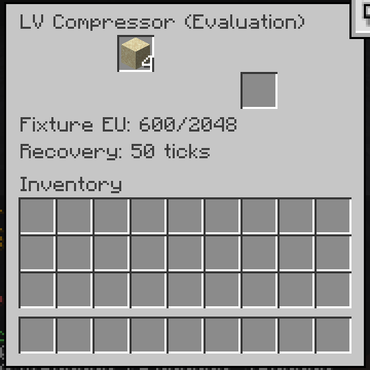

# Native Rust LV Compressor Evaluation

This is a small verified processing slice toward the complete GTNH pack: a native sand-to-sandstone compressor using Horizon's existing native/content mod boundary. The industrial simulation and basic machine policy remain separate Rust libraries. It uses explicit operator-supplied fixture energy; electrical networks and the full pack are unfinished.



The real menu shows a charged machine recovering for 50 ticks. The reserved inventory slot is hidden. This is a cropped game capture from the accepted save/reopen run, not a mockup. The energy label explicitly identifies fixture power.

## What was verified

The separate processing run matched all 1,204 measured GTNH 2.9.0 reference rows across normal power, shortage/recovery, and blocked output. It recorded 3,672 native samples: 1,224 machine ticks for each scenario. The shortage case spent 856 EU, including 256 EU of discarded work; the other two cases spent 600 EU each. The 64 items used to obstruct the output were fixture stock and were counted separately from production.

A second, four-session test used actual menu transfers and real world/region/player saves:

1. Save active work and a charged negative recovery countdown, unload the machine chunks, and reopen with exact policy bytes and inventory preserved.
2. Collect an existing output while the next batch is active, then save with the serialized output mirror still populated and the physical output slot empty.
3. Reopen that disagreement, reconcile it on the next loaded tick without recreating the item, finish both machines, and collect the remaining outputs.
4. Reopen with three sandstone in the player's inventory, then run ten idle ticks without output respawn, extra input consumption, or ledger changes.

The final disk save independently confirms these states:

| Machine | Completed batches | Spent EU | Wasted work EU | Sand remaining | Machine output |
| --- | ---: | ---: | ---: | ---: | ---: |
| Normal power | 2 | 1,200 | 0 | 0 | 0 |
| Shortage/recovery | 1 | 856 | 256 | 4 | 0 |

Independent review reconciled 1,226 trace rows, 38 full policy/menu observations, all four natural exits, 23,130 closed-profile files, and 27 region files for the persistence test. Both bounded invocations finished within ten minutes, with two CPUs, a verified 30-FPS cap, no forced termination, and zero server decode errors. The factual hashes and limits are in [verification metadata](lv-compressor-verification.json).

## Reproduce the source packages

From the repository root, use the [portable source tool](../tools/lv-compressor/README.md):

```sh
python tools/lv-compressor/package_compressor.py --output-dir tools/lv-compressor/build-example
```

The output directory must be a fresh child of the tool directory. The tool validates its locked source inputs and writes source-only `.hnmod` and `.hmod` archives. It does not contain a game executable, private world, raw reference export, or copied game texture.

Use a unique output path owned exclusively by one invocation. Concurrent writers to the same path are unsupported; on POSIX, an empty directory created during the final rename gap can be replaced. Package checks used Windows with Python 3.14.6: five passed and one symlink-creation check was skipped for missing Windows privileges. A separate real Windows junction rejection check passed. Python 3.11 and Unix execution remain untested.

The tested client uses Horizon revision `681124a485b82a27ac4e769756a2f3a2356e6827`, hook API 45, and SDK revision `3ac63df26d332bc344ba645d5d23497b7d4ad985`. The SDK's same-bundle library dependency fix was contributed as [draft upstream PR 18](https://github.com/horizon-rust/horizon-mixins/pull/18). This is a pinned development integration; stock-launcher installation of this LV bundle is not established. The [earlier reference compressor](reference-compressor.md) remains a separate prototype.

The SDK change's Windows validation reports 101 tests passing and seven failures matching untouched upstream; all 12 added tests pass. Its full suite is not all green. The bundle assembly and native gameplay checks described here are separate evidence.

## Limits

The measured processing comparison covers the sand recipe. Six catalog declarations are available, but this LV integration does not claim gameplay verification of every declaration. Fixture charging does not establish voltage packets or an electrical network. Native persistence does not establish original Java save/reopen semantics or original chained-job scheduling. Block removal/drop behavior, multiplayer, wider recipes, progression, and complete modpack parity remain unverified.

`LVBridgeTicks` is an integration diagnostic counter, not a claim about the original machine timer's save semantics. No migration from the earlier prototype is provided. These prototypes do not reduce the project's full one-to-one GTNH scope.
