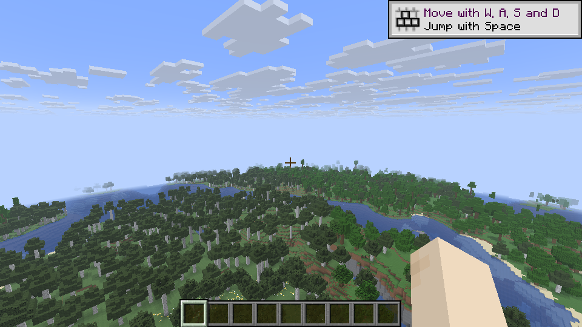

# Native engine capability baseline

The accepted API40 native client completed a bounded rendering, streaming and terrain-LOD baseline on November 1, 2026. Both flights, complete LOD generation, natural shutdown and preservation of every original/private input passed independent numerical review. This records existing Horizon capabilities in the tested executable, which includes the accepted local patch set identified by its source inventory hash. The complete GTNH pack remains unfinished and was not loaded for this run.

Actual engine capture from a new seed-5 creative world at 960×540. The final LOD state sampled all 864 target tiles with zero pending observations, 787 active tiles and 993,312 resident quads. The image verifies a populated distant-terrain scene; movement transitions, seams, distant-content parity and object LOD need separate checks.

The client used an NVIDIA GeForce RTX 4090, driver 617.42 and Vulkan. Both phases used two logical CPUs, BelowNormal priority, a 30-FPS cap and render distance 4. After a 15-second warmup and 10-second static sample, each 20-second flight followed identical endpoints; the second phase enabled terrain LOD distance 16 and allowed generation to settle before capture. On the observed Windows display,640×360 logical pixels produced960×540 physical output at 150% scaling. Actual renderer and PNG dimensions were checked.

| Measurement | LOD disabled | Terrain LOD 16 |
| --- | ---: | ---: |
| Raw frame/CPU/GPU samples | 587 each | 592 each |
| Frame time p95 | 34.907 ms | 34.047 ms |
| CPU time p95 | 5.328 ms | 9.405 ms |
| CPU time p99 | 13.012 ms | 18.903 ms |
| GPU time p99 | 0.110 ms | 1.377 ms |
| Generated chunks during flight | 132 | 226 |
| Meshed sections during flight | 3,141 | 4,395 |

The phases perform different work. These numbers establish no speedup, optimization or scaling result. CPU timing excludes waits for the GPU, display and frame limiter; GPU timestamp samples arrive asynchronously. At the final scene, backend counters reported 379,673,296 allocated GPU bytes and 872,415,232 reserved bytes. These are final allocator observations, not peak usage or total driver/system VRAM. Process RSS and individual worker timings were not measured.

The complete invocation finished in 158.067 seconds under a 600-second watchdog, with exit 0, no forced termination and confirmed process-tree cleanup. All 3,707 source files, both 23,065-file resource trees, executables, activation/build metadata and prepared-input metadata were verified unchanged. Earlier harness failures were preserved and excluded from acceptance: logical/physical sizing, cache invalidation from copied timestamps, incomplete post-flight LOD settlement and excessive verification overhead were corrected before this accepted run.

[Machine-readable measurements and evidence hashes](native-engine-baseline.json) identify the exact accepted build, source inventory, client, inputs, raw samples, command journal and screenshot. Private profiles, game binaries/assets and raw runtime logs are not distributed. The existing API40 manual build and separate API45 installed LV proof remain selected; this baseline activates no new engine or mod package.

| Requirement | Current evidence | Remaining work |
| --- | --- | --- |
| Cubic chunks | Standalone i64/16-cubed storage, journal and three-axis ticket experiments | Playable-world ownership, generation/light, physics, save migration and networking integration |
| Multithreading | Horizon worker pools exist; actual generation and meshing completed in this run | Worker activity/queue profiling, full-machine scaling and GTNH simulation scheduling |
| GPU acceleration | Native Vulkan rendering and valid frame timestamps on the real GPU | Whole-client residency budgets and any justified GPU simulation work |
| Native LOD | Complete terrain sampling and a reviewed static scene in the accepted client | Transitions, seams, content correctness, object LOD and GTNH integration |

No whole-pack performance or parity acceptance follows from this native-base workload.
