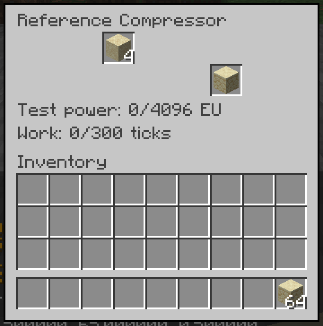

# GTNH Reference Compressor

Six reference-backed compressor recipes now run as an optional Horizon native mod and content pack. This is a processing prototype with explicit test power, not a complete GTNH machine or modpack.



Actual cropped capture from the passing offscreen gameplay run: one sandstone is ready to collect, four sand remain for a second batch, and the supplied energy is exhausted. The 64 sandstone in the player inventory came from removing an intentional output obstruction used by the test.

## Verified processing slice

| Input | Output |
|---|---|
| 4 sand | 1 sandstone |
| 4 clay balls | 1 clay block |
| 4 bricks | 1 brick block |
| 4 nether bricks | 1 nether-brick block |
| 4 snowballs | 1 snow block |
| 1 snow block | 1 ice |

The fixture uses the registered recipe declarations: 300 ticks, 2 EU/t, 600 EU per completed job, no fluids, and guaranteed output for these six cases. [Reference metadata](../reference/gtnh-2.9.0/compressor-declarations.json) distinguishes those declarations from full machine behavior. Actual GTNH machines apply further policies, including overclocking; this prototype does not establish their effective timing.

The native bundle maps host slot 0 to input and slot 2 to output. Slot 1 is reserved and hidden. The existing industrial simulation owns active recipe state; host slots own unconsumed stacks. Malformed state is rejected before an atomic update. Creation, loading, and ordinary ticks never supply energy.

On October 31, 2026, the actual Windows launcher built and installed `native-681124a-d943ed32c6cb`. A fresh offscreen game verified registration and an explicit one-time 600-EU charge. A separate full run then passed:

- Real player placement and menu insertion/collection for all six recipes; one output each, one unconsumed batch retained, and exactly 600 EU accounted for per machine.
- No processing without supplied power and no additional energy from repeated charge commands, ticks, or reloads.
- Active state at 137 ticks and 326 EU, followed by authoritative server chunk eviction. After 400 server ticks while absent, every machine reloaded with identical state.
- Actual region saves and three process reopens: active work, completed work with an obstructed output, and collected output/player inventory all persisted. Startup ticks can advance loaded machines before the test freezes the server; this is not offline catch-up.
- A full output held completed work without spending more energy; removing the obstruction released exactly one output.
- A top hopper fed only the input; the bottom hopper could not extract the unconsumed input. Hopper insertion did not start another job without energy.
- The independent native tick probe ran once per game process. All four processes exited cleanly, with no forced termination or native failure marker.
- The executable and every staged source, content, and resource file remained unchanged. The full run was bound to the earlier successful registration's complete input inventory.

The full bounded invocation took 201.997 seconds; its inner observation took 190.616 seconds. The adapter also passed 13 tests against actual API-45 library/save types, including binary NBT roundtrips. An isolated duplicated-input mutation was rejected by three existing tests. Nine observation-contract checks cover invalid ledgers, truncated data, authoritative ticks/deadlines, and process cleanup. [Verification metadata](reference-compressor-verification.json) records exact identities and limits.

## Reproduce the source packages

Requires Python 3.11 or newer. From this checkout, select a fresh output directory outside it:

```text
python tools/reference-compressor/package_compressor.py --pack-root . --output-dir ../gtnh-reference-compressor-bundles
```

The deterministic packager checks source allowlists and hashes and produces `gtnh_compressor_eval.hnmod`, `gtnh_compressor_eval.hmod`, and a receipt. The Rust library is drawn from this repository; templates, the adapter, and its bridge are readable under `tools/reference-compressor/`. No compiler or game is run by packaging.

For the exact two-mod composition used in verification, obtain `gtnh_tick_probe.hnmod` through the [existing proof packager](native-bundle-proof.md). Place the compressor and probe native archives in a disposable instance's `horizon-native-mods` folder, and the compressor content archive in its `horizon-mods` folder. Enable both IDs in `horizon-mods.txt`:

```text
mod.gtnh_compressor_eval:true
mod.gtnh_tick_probe:true
```

Use a launcher built from Horizon `681124a485b82a27ac4e769756a2f3a2356e6827`, Mixins `4342a0bfbe71d4d14185528d64e496d6022f16a1`, and the launcher's Rust 1.99.1 Windows GNU toolchain. Prepare the signed base and Minecraft 26.3 resources from your own game files, as described in the proof guide, then build:

```text
horizon-launcher native-build --instance <disposable-instance> --version nightly-2026-10-31-d91cab6 --profile fast --trust-native-code
```

In a separate world with commands enabled, obtain `gtnh_compressor_eval:reference_compressor`, place it, insert one of the listed inputs, and enter this command through player chat as a level-4 operator:

```text
/gtnhcompressor charge <x> <y> <z>
```

This supplies the validated 600-EU fixture charge once for that machine. The marker persists in its world data. It is deliberately an evaluation command, not a survival power source.

## Remaining work

Generators, fuel, electrical networks, overclocking, progression, complete recipe/item variants, and full mod compatibility are unfinished. Capacity and packet limits remain prototype policies. Ordinary removal currently drops host inventory and discards active recipe state; pinned GTNH source supports consumed-batch loss for ordinary breaking, but reference runtime removal, wrench, and explosion behavior remain unverified. Multiplayer, long-run stability, performance, and human playtesting are separate gates. The existing API-40 manual candidate and player profiles were not used by this proof.

The content archive references vanilla models and redistributes no game textures. This is an independent project and does not claim official GTNH or Horizon endorsement.
